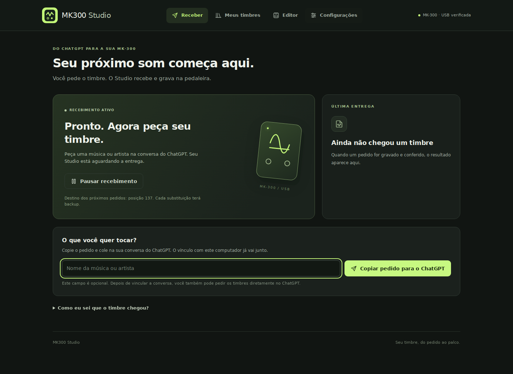

# MK300 Studio

Crie timbres na conversa do ChatGPT e receba na MK-300 por USB. O aplicativo roda no Windows; o navegador é sua interface. O logo e os ícones são locais, sem fontes externas.

## Abrir

1. Baixe o [ZIP completo](https://github.com/RickDiax/mvave/archive/refs/heads/main.zip) e extraia tudo. As pastas `studio`, `windows` e `mvave` devem permanecer juntas.
2. Abra `ABRIR-STUDIO.cmd`. Na primeira vez, o programa prepara as dependências com Python 3.12 ou 3.11 x64. Siga a orientação da janela se faltar o Python compatível.
3. Para um atalho com ícone na Área de Trabalho, execute `CRIAR-ATALHO.cmd` uma vez. Se mover a pasta, execute novamente.

O programa usa somente `127.0.0.1`, normalmente na porta 8765, e abre o navegador. Mantenha a janela do programa aberta. Ctrl+C encerra após a operação em andamento.

## Quatro áreas, quatro funções

**Receber timbres** é a tela principal: mostra se o recebimento está ativo, o destino escolhido e a última entrega confirmada. O campo de música/artista apenas prepara um pedido para copiar; não contém um serviço de IA embutido. Depois de vincular a conversa, você pode pedir diretamente no ChatGPT.

**Meus timbres** contém somente as versões salvas/recebidas neste computador. Não existe uma coleção de exemplos fixa. Importar um timbre ou backup abre um rascunho no editor sem gravar na pedaleira.

**Editor** permite abrir o preset atual ou uma posição salva, conferir efeitos e fazer ajustes opcionais. Nada muda no áudio enquanto você edita. **Conferir e enviar** mostra a posição e o nome antes de gravar. **Guardar em Meus timbres** salva uma versão local; **Baixar arquivo** exporta um arquivo do Studio, não um arquivo nativo do M-EFCS.

**Configurações** reúne portas MIDI, instrumento e destino dos pedidos. Nenhuma posição é escolhida de fábrica. O nome do preset de destino será mostrado antes de ativar o recebimento. A conexão configurada é lembrada, mas o recebimento precisa ser ativado novamente ao reiniciar.

Para o passo a passo do vínculo, compartilhamento e protocolo de entrega, consulte [Receber timbres pelo ChatGPT](../automation/LEIA-ME.md).

## Outras pessoas

Cada instalação recebe um canal exclusivo. Outra pessoa pode criar um fork público, conectar sua conta GitHub ao ChatGPT e informar o fork em Configurações → Entrega do ChatGPT. A biblioteca e os backups ficam na conta do Windows de cada pessoa. O programa não usa a caixa de entrada de Ricardo como alternativa e não entrega um timbre a todos.

Esta é uma ferramenta local, não um site público com login e serviço central de IA. Só instalar o programa não conecta automaticamente a conversa de outra pessoa ao repositório. O vínculo copiado pelo aplicativo informa ao ChatGPT o repositório e o canal corretos, sem senha/API key.

## Gravação e restauração

Antes da escrita, o Studio salva a imagem original do destino. Depois envia o preset, confirma e compara os 448 bytes lidos de volta. Não altera configurações globais nem carrega o preset automaticamente. Para ouvir o resultado salvo, troque a posição na pedaleira e volte ao destino.

Biblioteca: `%LOCALAPPDATA%\MK300Studio\timbres`.
Backups: `%LOCALAPPDATA%\MK300Studio\backups`.
Receitas recebidas: `%LOCALAPPDATA%\MK300Studio\recebidos`.
Vínculo/configuração: `%LOCALAPPDATA%\MK300Studio\receiver.json`.

Para recuperar um preset anterior, use **Meus timbres → Abrir arquivo de timbre ou backup** e escolha o backup. A imagem anterior abre como rascunho. Confira o destino e envie para restaurar. Se o resultado de uma escrita for incerto, confira a posição antes de tentar novamente.

## Limites

- Protocolo observado na V73; leitura e gravação pelo editor anterior foram confirmadas pelo usuário nesta unidade V75. A versão com canais separados precisa ser conferida fisicamente em cada unidade/firmware.
- Modelos seguem o catálogo de referência e a planilha fornecida. Nomes/conteúdo podem mudar entre bancos. Parâmetros ainda não decodificados não são adivinhados.
- Controles Ctrl A/B e expressão são preservados do preset original. No editor, uma posição de origem pode ser escolhida explicitamente para copiar todas essas atribuições.
- Capturas NAM/AM2 e IR continuam pelo M-EFCS. O preset não inclui os arquivos de captura/IR aos quais seus slots se referem.
- O ícone do atalho é personalizado; as associações dos arquivos JSON no Explorador do Windows não são modificadas.

## Desenvolvimento

`python -m unittest discover -s tests -v` valida o receptor, a separação dos canais, edição, backup e gravação simulada. `node tests/test_studio_ui.cjs` verifica os eventos da interface contra a API real, com DOM e USB simulados, sem instalar pacotes npm. Nenhum teste usa uma pedaleira física.
